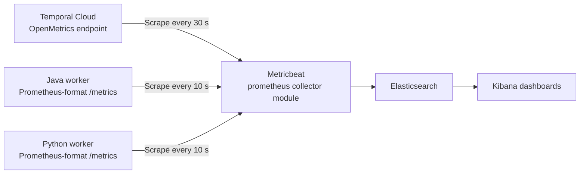

# Temporal Cloud metrics and history

Java and Python workers with Elastic metrics and a Postgres workflow-history archive.



Metricbeat pulls metrics directly from Cloud and worker endpoints. **No Prometheus server is deployed.** Prometheus names identify the metrics format, exporter libraries, and Metricbeat module. The diagram shows the metrics path; [history storage](audit/README.md) uses Postgres.

- [Metrics setup](elk/README.md): worker instrumentation, Metricbeat configuration, and three Kibana dashboards.
- [History options](audit/README.md): S3 export, archive-on-close, and polling; recommendations, setup, tradeoffs, and code references.

On Elastic 9.5+, consider [Elastic's Temporal Cloud integration](elk/README.md#optional-elastic-temporal-integration). This kit keeps Metricbeat for Elastic 8.19.24; SDK metrics collection is unchanged.

## Local setup

Requires Git, Docker Compose v2, curl, and a non-production Temporal Cloud namespace. Containers provide Java 21, Python 3.13, Elastic 8.19.24, and Postgres 17.

```bash
git clone https://github.com/technoidentity-kuncha/temporal-cloud-elk-kit.git
cd temporal-cloud-elk-kit
cp .env.example .env
chmod 600 .env
```

Set these values in [`.env`](.env.example):

- `TEMPORAL_ADDRESS`: regional gRPC endpoint from Temporal Cloud, including port 7233.
- `TEMPORAL_NAMESPACE`: full namespace name.
- `TEMPORAL_API_KEY`: namespace access for workers, execution listing, and history retrieval.
- `TEMPORAL_METRICS_API_KEY`: key for a Metrics Read-Only service account.

Start the [services](docker-compose.yml):

```bash
docker compose --profile workers up -d --build
docker compose --profile workers ps
```

Wait for healthy storage services and connected workers. [Import the dashboards](elk/README.md#import-dashboards), then run one minute of [sample traffic](workers/python/load.py):

```bash
docker compose --profile load run --rm load --rate 1 --duration 60
```

The sample starts orders on both SDK queues and creates shipment children. Payment declines are simulated.

- **Kibana:** [localhost:5601](http://localhost:5601). Allow several minutes for Cloud metrics.
- **Postgres:** `localhost:55432`, database `audit`, user/password `temporal` / `temporal`.
- **Worker metrics:** ports 9464 and 9465 inside Compose; not published on localhost.

After workflows finish:

```bash
docker compose --profile workers --profile load down
```

This stops workers, not Cloud executions. Elastic authentication is disabled in the demo. Removing the Postgres container can delete its data; configure persistent storage before retaining records. The history sweep must be scheduled separately.

## Source

Worker entry points: [Java](workers/java/src/main/java/example/orders/WorkerMain.java) and [Python](workers/python/worker.py). Configuration and implementation links are in the two setup guides.

[MIT license](LICENSE).
