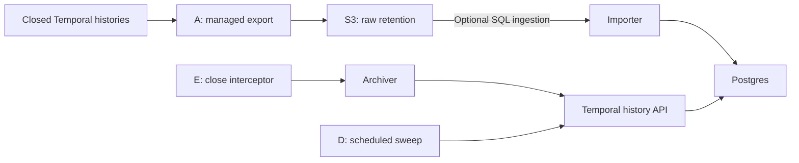

# Workflow history: retention and query access

Choose a history-retention approach, then provision, integrate, configure, and verify it in your environment. Linked code provides implementation references.

**Critical business outcomes belong in the application database for immediate querying.**

## Recommendation

- **Prefer Cloud History Export → S3** for long-term retention independent of application workers. Postgres ingestion is optional when SQL access is needed.
- **Use archive-on-close + sweep (E + D)** for prompt Postgres access. This is our preferred application-owned alternative.
- **Use sweep alone (D)** when periodic updates are sufficient. S3 export can accompany either application-owned approach as the raw-history archive.

**Implementation status:** reference implementations with [local validation](#validation). No continuous S3 consumer is included.

## 1. Cloud History Export → S3 → Postgres (A)

**Fits:** durable retention without application-worker changes; optional SQL access through a separate ingestion pipeline.

### Implementing this approach

- **Provision:** an S3 bucket and export access role following [Temporal's S3 configuration](https://docs.temporal.io/cloud/export/aws-export-s3). Add Postgres only if SQL access is needed; adapt the [sample schema](schema.sql) to your query requirements.
- **Integrate:** enable History Export for the namespace and destination bucket. For SQL ingestion, use [iter_export_blobs(), load_export(), and store()](history_loader.py) as references for reading protobuf batches and persisting execution/event records.
- **Configure:** bucket region, encryption, retention, and access policies. An optional importer needs S3 read/list access, decrypt permissions where applicable, and database credentials; it does not require Temporal mTLS.
- **Verify:** close representative workflows and confirm their histories arrive in S3. For SQL ingestion, compare Run IDs, event counts, and terminal events with the source histories; ingest the same batch twice to check duplicate handling. See [ingestion assertions](tests/e2e/test_archival.py).

For continuous ingestion, extend the batch pattern with [S3 notifications](https://docs.aws.amazon.com/AmazonS3/latest/userguide/ways-to-add-notification-config-to-bucket.html) → SQS → consumer. Commit before acknowledging messages; add retries, a dead-letter queue, and object reconciliation.

### Tradeoffs

- Export runs hourly; closed histories may take up to 24 hours to arrive. Delivery is at least once. [Export behavior](https://docs.temporal.io/cloud/export).
- Raw histories remain available for reprocessing; export, storage, and optional SQL ingestion add cost and operational responsibilities.
- The [batch importer](history_loader.py) rescans the prefix without an object checkpoint. Duplicate event keys are ignored; object tracking and continuous consumption remain deployment responsibilities.

## 2. Archive-on-close + scheduled sweep → Postgres (E + D)

**Fits:** prompt SQL access without archive calls inside each workflow's business logic.

### Implementing this approach

- **Provision:** Postgres storage and a dedicated archiver Worker with history API access and database write permissions. [archiver_worker.py](archiver_worker.py) shows registration on `history-archiver`; [archiver.py](archiver.py) waits for source closure, fetches the actual Run ID's history, and persists it.
- **Integrate:** register the [Java](../workers/java/src/main/java/example/orders/audit/ArchiveOnCloseInterceptor.java) or [Python](../workers/python/orders/archive_interceptor.py) interceptor on application workers. It starts an `ABANDON` child that survives parent closure. Registration examples: [Java](../workers/java/src/main/java/example/orders/WorkerMain.java), [Spring Boot](../workers/spring-boot/src/main/java/example/orders/spring/TemporalConfiguration.java), [Python](../workers/python/worker.py). Add [the recovery sweep](#3-temporal-schedule--sweep-workflow--postgres-d).
- **Configure:** the namespace and [API-key/mTLS connection](../elk/README.md#connection-configuration), matching archiver task queues, and `PG_DSN`. Set retry budgets within source-history retention. Preserve Java `getVersion()` / Python `patched()` guards through rollout and rollback.
- **Verify:** complete, fail, cancel, and Continue-As-New representative workflows; confirm each closed Run ID has its complete event set in Postgres. In a test environment, interrupt database access to verify retries, then confirm the sweep recovers terminated/timed-out runs. See [lifecycle and recovery tests](tests/e2e/test_archival.py).

Temporal references: interceptors ([Java](https://docs.temporal.io/develop/java/workers/interceptors), [Python](https://docs.temporal.io/develop/python/workers/interceptors)), child lifecycle ([Java](https://docs.temporal.io/develop/java/workflows/child-workflows), [Python](https://docs.temporal.io/develop/python/workflows/child-workflows)), and patching ([Java](https://docs.temporal.io/develop/java/workflows/versioning), [Python](https://docs.temporal.io/develop/python/workflows/versioning)).

### Tradeoffs

- Adds a child execution and Activity. The parent waits for child-start confirmation, not database delivery; this affects close latency.
- Termination and execution timeout bypass the closing code. Cancellation or child-start failures can also leave gaps; the sweep remains necessary.
- [Archiving retries](archiver.py) have a seven-day budget. Recovery must still finish before source-history retention expires. Sweeps reread histories already archived.

## 3. Temporal Schedule → sweep workflow → Postgres (D)

**Fits:** periodic SQL updates without changing application workers; also provides E's recovery path.

### Implementing this approach

- **Provision:** a sweep Worker and [Postgres storage/checkpoint](schema.sql) for each namespace. Grant the Schedule creator Schedule permissions, and the Worker listing/history access and database credentials.
- **Integrate:** create a [Temporal Schedule](sweep_schedule.py) targeting the sweep Worker's queue; register [HistorySweepWorkflow](sweep_workflow.py) and [sweep_closed_histories()](sweep_activity.py). The Activity invokes the [collector](history_loader.py), heartbeats, and stops its subprocess on cancellation. Schedule creation is separate from Worker deployment.
- **Configure:** the namespace, [connection profile](../elk/README.md#connection-configuration), `PG_DSN`, matching task queue, interval, and overlap policy. The reference collects hourly with `SKIP` and resumes from its checkpoint with a five-minute query overlap; the initial lookback is one hour. Keep credentials in Worker configuration; coordinate wider backfills within history retention.
- **Verify:** trigger a sweep and compare stored histories with closed runs in [Visibility](https://docs.temporal.io/visibility). Confirm the checkpoint advances only after a successful pass, remains unchanged on failure, and supports duplicate-safe retries. See [Schedule and checkpoint tests](tests/e2e/test_archival.py).

[Temporal Python Schedules](https://docs.temporal.io/develop/python/workflows/schedules) · [Overlap policies](https://python.temporal.io/temporalio.client.ScheduleOverlapPolicy.html).

### Tradeoffs

- Query freshness depends on scheduling, visibility delay, collection time, and Worker availability.
- [Activity attempts](sweep_workflow.py) have a 20-minute limit, at most three attempts, and a 55-minute overall budget; workload size determines suitable settings.
- Five concurrent history fetches in [poll_once()](history_loader.py) are not a rate limiter. `SKIP` prevents overlap for that Schedule, not other collectors or duplicate Activity execution.
- A checkpoint records progress, not completeness. Late visibility and prolonged outages can leave runs outside the recovery window.

## Storage considerations

The [Postgres schema](schema.sql) illustrates a query model, not a production-ready schema recommendation:

- `workflow_execution`: one execution summary per Run ID.
- `workflow_history_event`: event attributes as JSONB, keyed by Run ID and Event ID.
- `loader_checkpoint`: sweep progress.

[history_rows() and store()](history_loader.py) map and persist histories for all three paths. A production design needs namespace-aware identity, payload handling, reprocessing rules, and durable database storage. Raw S3 histories remain the recommended archival copy.

## Sample limits and validation

- **Payloads:** [decode_payloads()](history_loader.py) replaces unsupported/encrypted payloads with encoding/size placeholders. Postgres cannot reconstruct those payloads; retaining raw histories and required codecs/keys is necessary.
- **Identity:** [history_rows()](history_loader.py) uses actual Run IDs for E/D and the latest reset event's `new_run_id` for reset exports ([Temporal event definition](https://github.com/temporalio/api/blob/master/temporal/api/history/v1/message.proto)). Storage must remain separate per namespace.
- **Reprocessing:** [UPSERT_EVENT](history_loader.py) ignores duplicate event keys. Improving a decoder and rerunning ingestion will not replace existing payloads; correction requires an explicit update/rebuild strategy.

Operational checks include collection lag, failed archives/sweeps, checkpoint age, reconciliation gaps, and recovery time remaining before source retention expires.

### Validation

- **Tested:** real Temporal and Postgres with Java/Python interceptors, packaged Spring Boot, and scheduled sweeps. Scenarios include completion, failure, cancellation, timeout, termination, Continue-As-New, reset, replay, duplicate ingestion, payload handling, and database/checkpoint recovery.
- **Assertions:** stored event IDs/types, history lengths, and close status match source histories. S3 reads use Moto; export batches contain real server histories.

[Tests](tests/e2e/test_archival.py) · [CI](../.github/workflows/verify.yml) · [Run instructions (runner docstring)](../scripts/test_archival_e2e.py).
