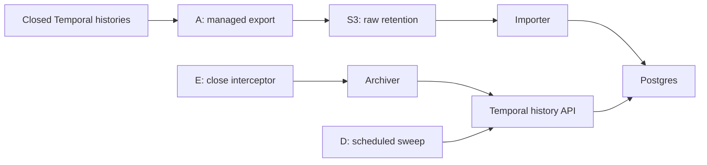
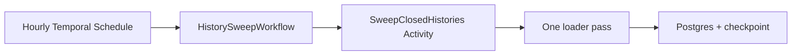

# Workflow history: retention and query access

**Persist critical business outcomes in the relevant application database for immediate querying.** This guide covers closed workflow histories.

## Recommendation

- **Prefer Cloud History Export → S3** for long-term retention independent of application workers. Import into Postgres when SQL access is needed.
- **Use archive-on-close + sweep (E + D)** for prompt Postgres access. This is our preferred application-owned alternative.
- **Use sweep alone (D)** when periodic updates are sufficient. S3 export can accompany either approach as the raw-history copy.

**Implementation status:** Temporal manages Cloud export. Our S3-to-Postgres importer is experimental: reset-run identity needs correction and real Cloud exports have not been validated. No SQS consumer is included. E + D and D are runnable examples; end-to-end Cloud/database delivery still needs client validation.



## 1. Cloud History Export → S3 → Postgres (A)

**Best for:** durable retention without worker changes; raw files remain available for reprocessing.

### Set it up

1. Create an S3 bucket in the namespace's AWS region, with appropriate encryption and retention. In Temporal Cloud, use **Export → Configure** and the guided CloudFormation role setup. Verify access and create the sink. [AWS export instructions](https://docs.temporal.io/cloud/export/aws-export-s3).
2. Close a test workflow and inspect its exported history. Validate the [importer](history_loader.py) against a bounded prefix using S3 read/list permissions and decrypt access where required. Resolve the sample limitations before production ingestion.
3. For continuous ingestion, build S3 `ObjectCreated` → SQS standard queue → consumer. Commit rows before acknowledging messages; add retries, a dead-letter queue, and object reconciliation. [AWS notification setup](https://docs.aws.amazon.com/AmazonS3/latest/userguide/ways-to-add-notification-config-to-bucket.html).

Experimental batch import into a disposable evaluation database, with `PG_DSN` and AWS credentials:

```bash
python -m pip install boto3
python audit/history_loader.py export \
  --path 's3://<bucket>/temporal-workflow-history/export/<namespace>/<year>/<month>/<day>/'
```

The sample reads protobuf batches from S3/local files and writes Postgres. It rescans the prefix; there is no object checkpoint or continuous consumer.

### Cons

- **Latency:** hourly exports may take up to 24 hours to arrive.
- **Operations:** delivery is at least once. Deduplicate imports and monitor export health, ingestion lag, and failed objects.
- **Cost:** export actions, storage, and ingestion add cost. Temporal manages export; your team owns the importer and database.

Reference: [export behavior and monitoring](https://docs.temporal.io/cloud/export).

## 2. Archive-on-close + scheduled sweep → Postgres (E + D)

**Best for:** prompt SQL access without archive calls in each workflow.

The interceptor starts an archiver child before parent closure. The child survives closure, waits for the closed run, then fetches its history. The sweep catches missed runs, including termination and execution timeout.

### Set it up

1. Deploy [archiver_worker.py](archiver_worker.py) on `history-archiver` with namespace credentials and `PG_DSN`.
2. Register the [Java interceptor](../workers/java/src/main/java/example/orders/audit/ArchiveOnCloseInterceptor.java) or [Python interceptor](../workers/python/orders/archive_interceptor.py) on every relevant worker, alongside existing interceptors. Registration examples: [Java](../workers/java/src/main/java/example/orders/WorkerMain.java), [Python](../workers/python/worker.py). Both use the same Python archiver.
3. Enable the [hourly sweep](#3-temporal-schedule--sweep-workflow--postgres-d). The close hook alone is insufficient.

```bash
python audit/archiver_worker.py
```

Implementation: [archive activity and child workflow](archiver.py).

### Cons

- **Workflow impact:** adds a child execution and archive activity. The parent waits for child-start confirmation. Measure close latency and preserve replay/version markers during rollout and rollback.
- **Coverage:** termination, execution timeout, cancellation, or start failures can bypass the hook. Retain the sweep.
- **Operations:** run the archiver and sweep workers. Archiving retries for up to seven days, but recovery must finish before retention expires. Sweeps also reread histories already archived.

## 3. Temporal Schedule → sweep workflow → Postgres (D)

**Best for:** periodic SQL updates without changing business workers; also E's recovery path.

### Code and setup

[history_loader.py](history_loader.py) contains the sweep: `load_poll()` reads the checkpoint; `poll_once()` lists closed runs, fetches histories by actual run ID, and writes Postgres.



The [Schedule adapter](sweep_schedule.py) starts the [workflow](sweep_workflow.py). Its [Activity](sweep_activity.py) runs the existing loader with retries, heartbeats, and cancellation cleanup. Credentials stay in the worker environment.

1. Deploy with the [Python dependencies](../workers/python/requirements.txt), [schema](schema.sql), and `TEMPORAL_ADDRESS`, `TEMPORAL_NAMESPACE`, `TEMPORAL_API_KEY`, and `PG_DSN`. Scripts do not read `.env`.
2. Start the worker, then create the Schedule once. Registration needs Schedule permissions; existing IDs are not overwritten.
3. Keep one Schedule per namespace/database pair. `SKIP` prevents overlapping runs from that Schedule. Pause it and wait for active collection to finish before manual backfills.

Commands from the repository root:

```bash
# Long-running service; separate one-time registration.
python audit/sweep_schedule.py worker
python audit/sweep_schedule.py create-schedule
```

Alternatively, with Compose:

```bash
docker compose --profile sweep up -d --build history-sweep
docker compose --profile sweep run --rm history-sweep \
  python sweep_schedule.py create-schedule
```

Starting Compose does not register the Schedule. For backfills within available retention:

```bash
python audit/history_loader.py poll --since 7d --overlap 300
```

The first scheduled pass looks back one hour unless a checkpoint exists. Successful passes advance it; a five-minute overlap covers recent visibility delays. Periodically reconcile a wider window and alert on failed sweeps or missing runs.

### Cons

- **Latency:** hourly scheduling plus visibility/processing delay. A worker must remain available.
- **Recovery:** attempts time out after 20 minutes, with at most three attempts within 55 minutes. Tune for workload size; later runs resume from the checkpoint.
- **Load/concurrency:** five concurrent fetches are not a rate limiter. Add throttling/batching for large backfills. `SKIP` does not coordinate other pollers or guarantee exactly-once Activity execution.
- **Retention:** outages or late visibility records can exceed the recovery window. A checkpoint does not prove completeness.

References: [Python Schedules](https://docs.temporal.io/develop/python/workflows/schedules) · [Overlap policies](https://python.temporal.io/temporalio.client.ScheduleOverlapPolicy.html) · [Schedule tests](tests/test_sweep_schedule.py).

## Verify an archived run

```sql
SELECT json_build_object('workflow_id', workflow_id, 'status', status,
                         'history_length', history_length)
FROM workflow_execution WHERE run_id = '<run-id>';
```

Illustrative result:

```json
{"workflow_id": "order-123", "status": "COMPLETED", "history_length": 42}
```

Event count should match `history_length`; a completed run ends with `WORKFLOW_EXECUTION_COMPLETED`. Repeated ingestion must not add duplicate events.

## Sample limits and validation

- **Payloads:** unsupported/encrypted payloads become placeholders. Postgres is not a lossless backup; retain raw histories and necessary codec/key access.
- **Identity:** export's `originalExecutionRunId` fallback can collide after reset; E/D use actual run IDs. Use separate storage per namespace because keys/checkpoints lack namespace identity.
- **Reprocessing:** duplicate event keys are ignored. Reloading does not correct existing payloads.
- **Validation:** test completion, failure, cancellation, timeout, termination, Continue-As-New, reset, replay, and database recovery. [Java tests](../workers/java/src/test/java/example/orders/ArchiveOnCloseInterceptorTest.java) and Schedule tests use stand-ins; they do not prove end-to-end database delivery.
