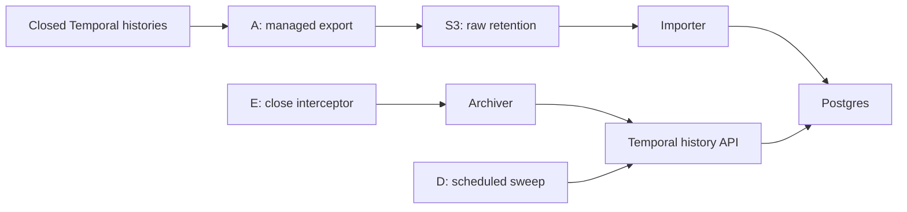
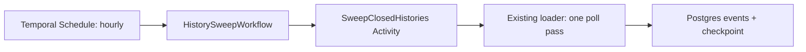

# Workflow history: retention and query access

**Persist critical business outcomes in the relevant application database so they are immediately queryable.** The approaches below retain closed workflow histories for investigation and later analysis.

## Recommendation

- **Prefer Cloud History Export → S3** for long-term retention: Temporal manages delivery, and raw histories remain available independently of application workers. Import into Postgres when SQL access is needed.
- **Use archive-on-close + sweep (E + D)** when prompt Postgres availability matters. This is our preferred application-owned alternative; the team operates collection and recovery.
- **Use sweep alone (D)** when periodic updates are sufficient and fewer components matter more than latency.

S3 export can run alongside E + D: S3 retains the raw copy; Postgres serves queries. Activity-attempt auditing (B) adds no necessary capability for this archive scope.



## 1. Cloud History Export → S3 → Postgres (A)

**Best for:** durable retention with no application-worker changes. Raw files can be reprocessed if the database or transformation changes.

### Set it up

1. **Create the export destination.** Use an S3 bucket in the namespace's AWS region; define encryption and retention. In Temporal Cloud, open the namespace's **Export → Configure** flow. The guided CloudFormation setup creates the export IAM role. Verify access and finish creating the sink. [AWS export instructions](https://docs.temporal.io/cloud/export/aws-export-s3).
2. **Validate delivery.** Close a test workflow and inspect the exported files. A successful configuration check proves write access, not end-to-end ingestion. Exports are protobuf batches; the [sample loader](history_loader.py) parses them with Temporal's generated classes.
3. **Validate the importer on a bounded prefix.** Give its AWS role list/read access to that prefix and decrypt access where required. Fix the sample limitations below before production ingestion.
4. **Automate ingestion.** Configure S3 `ObjectCreated` notifications for the export prefix → SQS standard queue → consumer. Process each object, commit its rows, then acknowledge the message. Add retries, a dead-letter queue, and periodic reconciliation of objects against successful imports. [AWS notification setup](https://docs.aws.amazon.com/AmazonS3/latest/userguide/ways-to-add-notification-config-to-bucket.html).

Example batch import, after configuring `PG_DSN` and AWS credentials:

```bash
python -m pip install boto3
python audit/history_loader.py export \
  --path 's3://<bucket>/temporal-workflow-history/export/<namespace>/<year>/<month>/<day>/'
```

**Included:** recursive S3/local-file reader and Postgres writer. **Not included:** SQS consumer, object checkpointing, or deployment infrastructure. The command rescans its prefix; it is not a continuous ingestion service.

### Cons and operating considerations

- **Delay:** exports run hourly and can take up to 24 hours to arrive. This path cannot provide immediate query access.
- **Delivery:** at-least-once delivery requires deduplication. Monitor export health, ingestion lag, and queue failures. Repeated export failures can disable the sink.
- **Cost and ownership:** export actions, object storage, queueing, and database ingestion add cost. Temporal manages export; your team manages ingestion and retention.
- **Sample gaps:** reset-run identity handling must be corrected, and the importer has not been validated against Cloud-written files. See [sample limits](#sample-limits-and-validation).

Delivery behavior and monitoring: [Temporal Cloud History Export](https://docs.temporal.io/cloud/export).

## 2. Archive-on-close + scheduled sweep → Postgres (E + D)

**Best for:** faster post-close SQL access without adding archive calls to each workflow.

The worker interceptor starts an archiver child before the parent closes. The child survives parent closure, waits until the run is closed, then fetches and stores its history. The sweep covers runs missed by the hook, including termination and execution timeout.

### Set it up

1. **Deploy the archiver first.** Run [archiver_worker.py](archiver_worker.py) as a supervised service polling `history-archiver`, with namespace credentials and `PG_DSN`.
2. **Register the interceptor on all relevant workers.** Add it alongside existing interceptors; preserve their registration. Use the Java/Python examples below. The same Python archiver serves both SDKs.
3. **Schedule the sweep.** Use the [D setup below](#3-temporal-schedule--sweep-workflow--postgres-d), initially hourly. It is required even when the hook appears reliable.
4. **Validate before rollout.** Test normal closure, failure, cancellation, Continue-As-New, termination, timeout, replay, and database outage/recovery. Confirm missed hook deliveries are recovered by the sweep.

Start the archiver:

```bash
python audit/archiver_worker.py
```

Java registration fragment—merge into the existing factory configuration:

```java
WorkerFactoryOptions.newBuilder()
    .setWorkerInterceptors(new ArchiveOnCloseInterceptor("history-archiver"))
    .build();
```

Python registration—retain your existing worker arguments and interceptors:

```python
from orders.archive_interceptor import ArchiveOnCloseInterceptor

worker = Worker(
    client,
    task_queue=task_queue,
    workflows=workflow_types,
    activities=activity_functions,
    interceptors=[*existing_interceptors, ArchiveOnCloseInterceptor()],
)
```

Copy/adapt: [Java interceptor](../workers/java/src/main/java/example/orders/audit/ArchiveOnCloseInterceptor.java) · [Java registration](../workers/java/src/main/java/example/orders/WorkerMain.java) · [Python interceptor](../workers/python/orders/archive_interceptor.py) · [Python registration](../workers/python/worker.py) · [Archiver logic](archiver.py).

### Cons and operating considerations

- **Workflow integration:** adds a child execution and archive activity. The parent waits for child-start confirmation, so this is not zero-impact instrumentation. Measure close latency and preserve replay/version markers during rollout and rollback.
- **More components:** operate the archiver worker and sweep; monitor failures and backlog. All workers handling the relevant workflows need the interceptor.
- **Incomplete hook coverage:** termination/execution timeout can bypass workflow code. Cancellation or other start failures can also leave gaps; never rely on E alone.
- **Bounded recovery:** the archive activity retries for up to seven days. That does not guarantee delivery before namespace retention expires. The sweep also rereads histories already archived, consuming API and database capacity.

## 3. Temporal Schedule → sweep workflow → Postgres (D)

**Best for:** periodic SQL updates without changing business workers. Also serves as E's recovery path. Temporal manages the schedule; a sweep worker executes the collection.

### Existing code and execution path

The sweep is implemented in [history_loader.py](history_loader.py): `load_poll()` reads the checkpoint, and `poll_once()` lists closed runs through Visibility, fetches their histories by actual run ID, and writes Postgres.

The [Schedule adapter](sweep_schedule.py) reuses that loader:



The [workflow](sweep_workflow.py) handles Activity retries. The [Activity](sweep_activity.py) runs one loader process, sends heartbeats, and stops the process on cancellation. Database/API work stays outside Workflow code; credentials stay in the worker environment.

### Set it up

1. **Deploy the sweep worker.** Use the [Python dependencies](../workers/python/requirements.txt), [Postgres schema](schema.sql), and environment variables `TEMPORAL_ADDRESS`, `TEMPORAL_NAMESPACE`, `TEMPORAL_API_KEY`, and `PG_DSN`. Scripts do not read `.env`. The worker polls `history-sweep`.
2. **Create the Schedule once** with credentials permitted to create Schedules. It starts an hourly sweep with overlap policy `SKIP`: a scheduled run is skipped while the preceding Workflow is open. Existing Schedule IDs are not overwritten; manage changes through Temporal's UI/API.
3. **Keep one Schedule per namespace/database pair.** Do not run another poller against the same checkpoint. For a manual backfill, pause the Schedule and wait for its active run to finish, run the backfill, then resume.
4. **Monitor and reconcile.** Track Schedule actions, failed sweep Workflows, and missing archived runs. Periodically scan a wider window for late Visibility records. Schedule catch-up starts missed actions; the database checkpoint determines which histories are scanned.

Commands from the repository root:

```bash
# Long-running worker service.
python audit/sweep_schedule.py worker

# Separate, one-time registration; does not start the worker.
python audit/sweep_schedule.py create-schedule
```

For an initial backfill or manual recovery, the original loader remains available:

```bash
python audit/history_loader.py poll --since 7d --overlap 300
```

Without a checkpoint, scheduled collection initially looks back one hour. Successful passes advance the checkpoint; retries resume from it. The five-minute overlap rereads recent runs, and event keys prevent duplicate inserts. Choose the initial backfill within available retention.

References: [Temporal Python Schedules](https://docs.temporal.io/develop/python/workflows/schedules) · [Overlap policies](https://python.temporal.io/temporalio.client.ScheduleOverlapPolicy.html) · [Schedule/Activity tests](tests/test_sweep_schedule.py).

### Cons and operating considerations

- **Latency:** availability follows the hourly interval plus visibility and processing delays. Temporal Schedules remove the external scheduler, not the need for an available worker.
- **Recovery limits:** each Activity attempt has a 20-minute timeout, at most three attempts, and a 55-minute total budget. Size these for the workload; later scheduled runs can resume from the checkpoint after a failed run.
- **Concurrency:** `SKIP` applies to this Schedule's Workflows, not other Schedules, manual pollers, or all possible duplicate Activity attempts. Writes must remain idempotent.
- **API load:** overlaps and backfills refetch histories. Five concurrent fetches are not a request-rate limiter; add throttling and bounded batching before large backfills.
- **Retention exposure:** outages or late Visibility records can outlast the recovery window. Leave headroom for catch-up; a checkpoint alone does not prove completeness.

## Sample limits and validation

- **Payload fidelity:** the loader replaces unsupported/encrypted payloads with placeholders. Postgres is not a lossless backup; retain raw histories and the codec/key access needed to decode protected payloads.
- **Namespace isolation:** use separate storage per namespace; the sample schema and checkpoint do not include namespace identity.
- **Export identity:** the importer falls back to `originalExecutionRunId`, which can collide after reset. E/D use actual run IDs. Resolve this before importing production exports.
- **Idempotency:** events use `(run_id, event_id)` and ignore duplicate inserts. Replaying a file/sweep does not correct an existing event's payload; corrections need a deliberate reprocessing strategy.
- **Acceptance:** compare event counts and terminal events with Temporal, repeat ingestion to check deduplication, and test recovery after database failure. The [Java tests](../workers/java/src/test/java/example/orders/ArchiveOnCloseInterceptorTest.java) exercise interception/replay with a fake archiver; they do not establish end-to-end database delivery.
