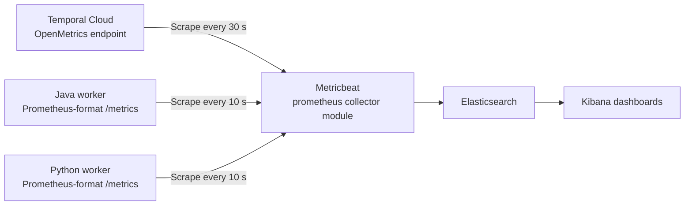

# Temporal metrics in Elastic



Metricbeat scrapes Cloud OpenMetrics and worker Prometheus-format endpoints directly. **No Prometheus server is deployed.** `module: prometheus` selects a collector inside Metricbeat; it does not start a separate service.

For the local stack, follow [Local setup](#local-setup). All commands below run from the repository root.

## Optional Elastic Temporal integration

Use [Elastic's Temporal OpenTelemetry integration](https://www.elastic.co/docs/reference/integrations/temporal) on **Elastic 9.5+** for guided Cloud collection and packaged dashboards, alert templates, and SLO templates. It scrapes [Temporal Cloud OpenMetrics](https://docs.temporal.io/cloud/metrics/openmetrics/metrics-reference); no Prometheus server is required.

This kit keeps **Metricbeat** for Elastic 8.19.24 and its existing dashboards. Switching Cloud collection changes fields from `prometheus.*` to `metrics.*`, so custom Cloud panels need updating. Replace the existing Cloud scrape job to avoid duplicate collection.

**SDK metrics are unchanged:** this integration covers Cloud metrics only. Keep the Java/Python instrumentation, worker endpoints, and Metricbeat worker scrape jobs.

## Configure workers

- **Java:** use [WorkerMain.java](../workers/java/src/main/java/example/orders/WorkerMain.java) and its [dependencies](../workers/java/pom.xml). `MicrometerClientStatsReporter` connects Temporal's metrics scope to Micrometer's Prometheus-format exporter. Expose that registry through `/metrics`. With Spring Boot, reuse the application registry and expose `/actuator/prometheus`, which serves the same format.
- **Python:** use [worker.py](../workers/python/worker.py). `PrometheusConfig` enables Prometheus-format output in the worker. Keep `counters_total_suffix`, `unit_suffix`, and `durations_as_seconds` enabled, and pass the runtime to `Client.connect`.

Keep the `sdk` and `service` labels. Request each endpoint from the collector network after running workflows; expect `temporal_*` series and duration buckets. Scrape each worker instance, not a load-balanced address.

## Configure Metricbeat

Edit [metricbeat.yml](metricbeat/metricbeat.yml):

- Set namespace, worker hosts, endpoint paths, Elasticsearch credentials, and TLS.
- Use a Metrics Read-Only service-account key for the Cloud endpoint. An Account Owner or Global Admin creates the account and key.
- Keep `use_types: true`, `rate_counters: true`, and root-level `source_kind` values `temporal_cloud` and `temporal_sdk`.
- Scrape workers every 10 seconds. Run one Cloud job per account every 30 seconds: 120 requests/hour against the documented limit of 180.

Run `metricbeat test config` and `metricbeat test output` in the collector environment. For Kubernetes, discover each worker pod once and keep Cloud collection in a separate job. Discovery manifests and Fleet policies are not included. Check field mappings before substituting Elastic Agent.

Metricbeat stores parsed metrics under `prometheus.*`; this is a field prefix, not a Prometheus database. The dashboards use these fields and histogram data. Switching to Micrometer's Elasticsearch registry requires different mappings and does not preserve these histogram panels.

## Import dashboards

Import [temporal-dashboards.ndjson](kibana/temporal-dashboards.ndjson) through **Kibana → Stack Management → Saved Objects**, or use the local API:

```bash
curl --fail-with-body -sS \
  -X POST 'http://localhost:5601/api/saved_objects/_import' \
  -H 'kbn-xsrf: true' \
  --form file=@elk/kibana/temporal-dashboards.ndjson
```

Check `success: true` and no import errors. Resolve conflicts before replacing existing objects. For secured Kibana, add authentication; a non-default space uses `/s/<space-id>/api/saved_objects/_import`.

The data view uses `metricbeat-*`. Change `data_view()` in [build_dashboards.py](kibana/build_dashboards.py) if needed, then regenerate:

```bash
python3 elk/kibana/build_dashboards.py
```

## Checks and troubleshooting

In Discover, select **Last 15 minutes** and check both `source_kind : "temporal_sdk"` and `source_kind : "temporal_cloud"`. Allow several minutes for Cloud data. Open **Worker capacity overview**, **SDK workers (Java + Python)**, and **Cloud namespace health**; all panels should render.

- **Empty panels:** check collector logs, credentials, endpoint access, data view, and `source_kind`. Failure metrics may be absent until a failure occurs.
- **HTTP 429:** check for duplicate Cloud jobs and account-wide request volume.
- **Different SDK series:** check Python exporter flags, labels, and units.
- **Percentiles plateau:** inspect histogram bucket bounds. Increase Java timer `maximumExpectedValue` through a Micrometer `MeterFilter` before creating the reporter if the configured range is too short.

## Metric interpretation

Schedule-to-start measures task waiting time. Compare it with backlog age and available slots; inspect downstream latency before increasing capacity. Async activities also occupy slots. Workflow-task failures differ from terminal workflow failures.

Cloud throughput metrics are rates; backlog count is a quantity. Combining Cloud p95 values does not produce a fleet or longer-window p95. Check SDK histogram bounds and whether samples are cumulative or interval-based before using percentiles for SLOs. Metricbeat's counter `.rate` is the increment between scrapes. Typed collection is marked beta by Elastic.

[Cloud metrics](https://docs.temporal.io/cloud/metrics/openmetrics/metrics-reference) · [API limits](https://docs.temporal.io/cloud/metrics/openmetrics/api-reference) · [Metricbeat collector](https://www.elastic.co/docs/reference/beats/metricbeat/metricbeat-metricset-prometheus-collector)

## Local setup

Requires Git, Docker Compose v2, curl, and a non-production Temporal Cloud namespace. Containers provide Java 21, Python 3.13, Elastic 8.19.24, and Postgres 17.

```bash
git clone https://github.com/technoidentity-kuncha/temporal-cloud-elk-kit.git
cd temporal-cloud-elk-kit
cp .env.example .env
chmod 600 .env
```

Set these values in [`.env`](../.env.example):

- `TEMPORAL_ADDRESS`: regional gRPC endpoint from Temporal Cloud, including port 7233.
- `TEMPORAL_NAMESPACE`: full namespace name.
- `TEMPORAL_API_KEY`: namespace access for workers, execution listing, and history retrieval.
- `TEMPORAL_METRICS_API_KEY`: key for a Metrics Read-Only service account.

Start the [services](../docker-compose.yml):

```bash
docker compose --profile workers up -d --build
docker compose --profile workers ps
```

Wait for healthy storage services and connected workers. [Import the dashboards](#import-dashboards), then run one minute of [sample traffic](../workers/python/load.py):

```bash
docker compose --profile load run --rm load --rate 1 --duration 60
```

The sample starts orders on both SDK queues and creates shipment children. Payment declines are simulated.

- **Kibana:** [localhost:5601](http://localhost:5601). Allow several minutes for Cloud metrics.
- **Postgres:** `localhost:55432`, database `audit`, user/password `temporal` / `temporal`.
- **Worker metrics:** ports 9464 and 9465 inside Compose; not published on localhost.

After workflows finish:

```bash
docker compose --profile workers --profile load down
```

This stops workers, not Cloud executions. Elastic authentication is disabled in the demo. Removing the Postgres container can delete its data; configure persistent storage before retaining records. The history sweep must be scheduled separately.
