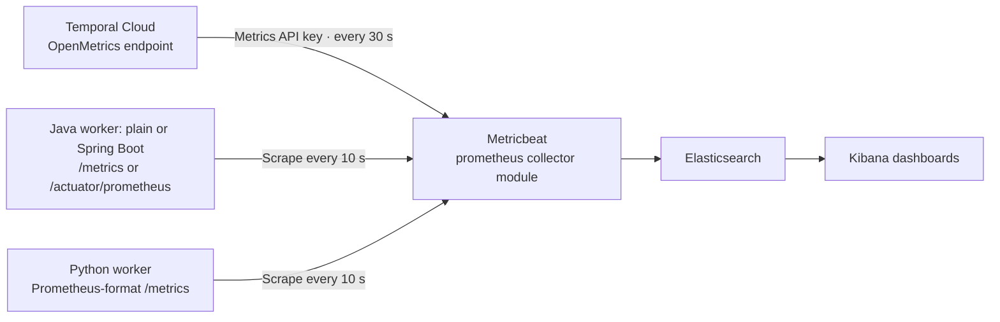
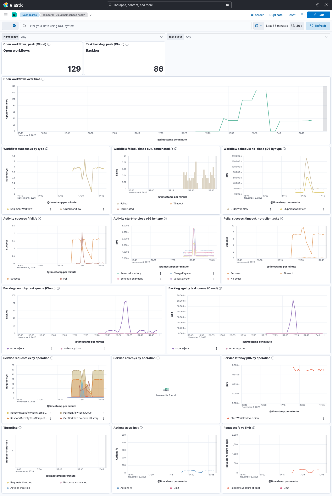

# Temporal metrics in Elastic



Metricbeat scrapes Cloud OpenMetrics and worker Prometheus-format endpoints directly. **No Prometheus server is deployed.** `module: prometheus` selects a collector inside Metricbeat; it does not start a separate service.

Start with [Local setup](#local-setup), choose [connection configuration](#connection-configuration), then optionally select [Spring Boot](#optional-spring-boot-worker). All commands run from the repository root in a POSIX shell.

## Authentication boundaries

- **Workers and audit collectors → Temporal:** use an API key **or** mTLS for namespace access. mTLS is optional; it does not enable or secure metrics collection. [Temporal authentication](https://docs.temporal.io/cloud/certificates).
- **Metricbeat → Cloud metrics:** use a separate Metrics Read-Only API key, including when workers use mTLS. [OpenMetrics authentication](https://docs.temporal.io/cloud/metrics/openmetrics/api-reference).
- **Metricbeat → worker endpoints / Elastic:** separate connections. Worker endpoints use private HTTP in this sample; Elastic security is disabled for the demo. Temporal client certificates do not secure either connection.

## Local setup

Requires Git, Docker Compose v2, curl, and a non-production Temporal Cloud namespace. Containers provide Java 21, Python 3.13, Elastic 8.19.24, and Postgres 17.

```bash
git clone https://github.com/technoidentity-kuncha/temporal-cloud-elk-kit.git
cd temporal-cloud-elk-kit
cp .env.example .env
chmod 600 .env
```

Continue below to choose authentication and the Java worker variant.

## Connection configuration

The [Java](../workers/java/src/main/java/example/orders/WorkerMain.java) and [Python](../workers/python/worker.py) entry points use [Temporal Environment Configuration](https://docs.temporal.io/develop/environment-configuration): TOML profiles plus environment overrides. The archiver, loader, and Schedule client use the same configuration. Queue names, metrics ports, and `PG_DSN` remain application settings.

### API key: simplest Compose setup

Set these in [`.env`](../.env.example):

```dotenv
COMPOSE_FILE=docker-compose.yml
TEMPORAL_ADDRESS=<regional-endpoint>:7233
TEMPORAL_NAMESPACE=<namespace>.<account>
TEMPORAL_API_KEY=<namespace-access-key>
TEMPORAL_METRICS_API_KEY=<metrics-read-only-key>
```

Use endpoint/namespace values from Temporal Cloud. The [namespace API key](https://docs.temporal.io/cloud/api-keys) needs the worker and history API permissions used by this sample; the metrics key belongs to a service account with Metrics Read-Only access.

### Optional TOML profiles

```bash
cp config/temporal.example.toml config/temporal.toml
mkdir -p certs
chmod 600 config/temporal.toml
```

Edit `cloud-api-key` in the [profile template](../config/temporal.example.toml), then replace/add these `.env` settings:

```dotenv
COMPOSE_FILE=docker-compose.yml:docker-compose.auth.yml
TEMPORAL_CONFIG_FILE=/etc/temporal/temporal.toml
TEMPORAL_PROFILE=cloud-api-key
```

Remove `TEMPORAL_ADDRESS` from `.env`. Keep the namespace API key, metrics key, and `TEMPORAL_NAMESPACE`; the namespace must match TOML because Metricbeat reads it separately. **Environment values override TOML.** Remove stale TLS/key overrides when changing authentication.

The [auth override](../docker-compose.auth.yml) mounts the profile and `certs/` read-only for workers, archiver, sweep, and load generator. Files in `config/temporal.toml` and `certs/` are excluded from Git and Docker builds.

### Optional mTLS

Use the TOML setup above, then:

1. Configure the namespace's trusted client CA and issue a client certificate following [Temporal Cloud's requirements](https://docs.temporal.io/cloud/certificates).
2. Set `TEMPORAL_PROFILE=cloud-mtls` in `.env` and remove `TEMPORAL_API_KEY`. Edit that profile's namespace and certificate-authentication endpoint from Temporal Cloud.
3. Put the PEM certificate chain in `certs/client.pem` and unencrypted PKCS#8 key in `certs/client.key`; restrict key access. The template references their container paths under `/run/temporal-certs/`.

Keep server-certificate verification enabled. `server_ca_cert_path` is only for a private server CA. Restart clients after certificate rotation. **Keep `TEMPORAL_METRICS_API_KEY`: worker mTLS does not replace it or change SDK metrics.**

### Processes outside Compose

Install the relevant [Java](../workers/java/pom.xml) or [Python](../workers/python/requirements.txt) dependencies. Scripts/JVMs do not read `.env`; export `TEMPORAL_CONFIG_FILE` with an absolute host path and `TEMPORAL_PROFILE`, plus `TEMPORAL_API_KEY` for key authentication. Certificate paths in TOML must exist on that host. Without connection settings, clients default to `localhost:7233` / `default`.

## Optional Spring Boot worker

Use this when your application already uses Spring Boot. It replaces the plain Java worker; Python workers and history collection stay the same. Temporal's official starter registers the existing Java workflows, activities, and archive interceptor.

For environment-only authentication, set this in `.env`:

```dotenv
COMPOSE_FILE=docker-compose.yml:docker-compose.spring.yml
```

For TOML/mTLS, use `COMPOSE_FILE=docker-compose.yml:docker-compose.auth.yml:docker-compose.spring.yml` instead. Then [start the stack](#run-the-stack). The [Spring override](../docker-compose.spring.yml) keeps service `java-worker` and queue `orders-java`, and switches Metricbeat to `/actuator/prometheus`.

Code references:

- [TemporalConfiguration.java](../workers/spring-boot/src/main/java/example/orders/spring/TemporalConfiguration.java): profile loading, client options, activity bean, and archive interceptor registration.
- [application.yml](../workers/spring-boot/src/main/resources/application.yml): workflow classes, activity bean, queue, slot limit, metrics port, and labels. Connection settings come from Temporal profiles/environment. Keep the starter activation target; `local` bypasses the connection customizer.
- [Integration test](../workers/spring-boot/src/test/java/example/orders/spring/SpringWorkerTest.java): shared workflows, archiver starts, and Actuator metrics. Uses an archiver stand-in; does not prove database delivery.

[Temporal Spring Boot documentation](https://docs.temporal.io/develop/java/integrations/spring-boot-integration).

## Run the stack

`.env` records the selected Compose files; the commands are identical for all variants. Remove any shell `COMPOSE_FILE` override; shell values take precedence over `.env`.

```bash
docker compose --profile workers config --quiet
docker compose --profile workers up -d --build
docker compose --profile workers ps
```

Wait for healthy storage services and connected workers; inspect failures with `docker compose --profile workers logs --tail=50`. [Import the dashboards](#import-dashboards), then run one minute of [sample traffic](../workers/python/load.py):

```bash
docker compose --profile load run --rm load --rate 1 --duration 60
```

This starts one order/second on **each** SDK queue and creates shipment children. Payment declines are simulated.

- **Kibana:** [localhost:5601](http://localhost:5601). Allow several minutes for Cloud metrics; use the [checks](#checks-and-troubleshooting) to verify both sources.
- **Postgres:** `localhost:55432`, database `audit`, user/password `temporal` / `temporal`.
- **Worker metrics:** ports 9464 and 9465 inside Compose; not published on localhost.
- **History:** the demo also starts Postgres and the Python archiver. [Audit guidance](../audit/README.md) covers retention and querying; the optional `sweep` profile needs separate Schedule registration.

Stop the stack after workflows finish:

```bash
docker compose --profile workers --profile load --profile sweep down
```

Stopping workers does not stop Cloud executions or delete Temporal Schedules. Pause the sweep Schedule if no worker will remain. Postgres uses an anonymous volume: a later `up` may not reuse its data. Configure named/persistent storage before retaining records.

## Configure workers

- **Java:** use [WorkerMain.java](../workers/java/src/main/java/example/orders/WorkerMain.java) and its [dependencies](../workers/java/pom.xml). [Java metrics instrumentation](https://docs.temporal.io/develop/java/platform/observability#metrics) connects Temporal's metrics scope through `MicrometerClientStatsReporter` to Micrometer's Prometheus-format exporter. Expose that registry through `/metrics`. The [optional Spring Boot worker](#optional-spring-boot-worker) reuses these classes and exposes `/actuator/prometheus`.
- **Python:** use [worker.py](../workers/python/worker.py). [Python metrics instrumentation](https://docs.temporal.io/develop/python/platform/observability#metrics) uses `PrometheusConfig` for Prometheus-format output. Keep `counters_total_suffix`, `unit_suffix`, and `durations_as_seconds` enabled, and pass the runtime to `Client.connect`.

Keep the `sdk` and `service` labels. Request each endpoint from the collector network after running workflows; expect `temporal_*` series and duration buckets. Scrape each worker instance, not a load-balanced address.

## Configure Metricbeat

Edit [metricbeat.yml](metricbeat/metricbeat.yml):

- Set namespace, worker hosts, endpoint paths, Elasticsearch credentials, and TLS.
- Use a Metrics Read-Only service-account key for the Cloud endpoint. An Account Owner or Global Admin creates the account and key.
- Keep `use_types: true`, `rate_counters: true`, and root-level `source_kind` values `temporal_cloud` and `temporal_sdk`.
- Scrape workers every 10 seconds. Run one Cloud job per account every 30 seconds: 120 requests/hour against the documented limit of 180.

Run `metricbeat test config` and `metricbeat test output` in the collector environment. For Kubernetes, discover each worker pod once and keep Cloud collection in a separate job. Discovery manifests and Fleet policies are not included. Check field mappings before substituting Elastic Agent.

Metricbeat stores parsed metrics under `prometheus.*`; this is a field prefix, not a Prometheus database. The dashboards use these fields and histogram data. Switching to Micrometer's Elasticsearch registry requires different mappings and does not preserve these histogram panels.

## Import dashboards

Import [temporal-dashboards.ndjson](kibana/temporal-dashboards.ndjson) through **Kibana → Stack Management → Saved Objects**, or use the local API:

```bash
curl --fail-with-body -sS \
  -X POST 'http://localhost:5601/api/saved_objects/_import' \
  -H 'kbn-xsrf: true' \
  --form file=@elk/kibana/temporal-dashboards.ndjson
```

Check `success: true` and no import errors. Resolve conflicts before replacing existing objects. For secured Kibana, add authentication; a non-default space uses `/s/<space-id>/api/saved_objects/_import`.

The data view uses `metricbeat-*`. Change `data_view()` in [build_dashboards.py](kibana/build_dashboards.py) if needed, then regenerate:

```bash
python3 elk/kibana/build_dashboards.py
```

<details>
<summary>Example: Cloud namespace health dashboard</summary>



Example workload; values vary. Empty error panels can mean no failures occurred.

</details>

## Checks and troubleshooting

In Discover, select **Last 15 minutes** and check both `source_kind : "temporal_sdk"` and `source_kind : "temporal_cloud"`. Allow several minutes for Cloud data. Open **Worker capacity overview**, **SDK workers (Java + Python)**, and **Cloud namespace health**; all panels should render.

- **Empty panels:** check collector logs, credentials, endpoint access, data view, and `source_kind`. Failure metrics may be absent until a failure occurs.
- **HTTP 429:** check for duplicate Cloud jobs and account-wide request volume.
- **Different SDK series:** check Python exporter flags, labels, and units.
- **Percentiles plateau:** inspect histogram bucket bounds. Increase Java timer `maximumExpectedValue` through a Micrometer `MeterFilter` before creating the reporter if the configured range is too short.

## Metric interpretation

Schedule-to-start measures task waiting time. Compare it with backlog age and available slots; inspect downstream latency before increasing capacity. Async activities also occupy slots. Workflow-task failures differ from terminal workflow failures.

Cloud throughput metrics are rates; backlog count is a quantity. Combining Cloud p95 values does not produce a fleet or longer-window p95. Check SDK histogram bounds and whether samples are cumulative or interval-based before using percentiles for SLOs. Metricbeat's counter `.rate` is the increment between scrapes. Typed collection is marked beta by Elastic.

[SDK metric definitions](https://docs.temporal.io/references/sdk-metrics) · [Cloud metrics](https://docs.temporal.io/cloud/metrics/openmetrics/metrics-reference) · [API limits](https://docs.temporal.io/cloud/metrics/openmetrics/api-reference) · [Metricbeat collector](https://www.elastic.co/docs/reference/beats/metricbeat/metricbeat-metricset-prometheus-collector)

## Optional Elastic Temporal integration

Use [Elastic's Temporal OpenTelemetry integration](https://www.elastic.co/docs/reference/integrations/temporal) on **Elastic 9.5+** for guided Cloud collection and packaged dashboards, alert templates, and SLO templates. It scrapes [Temporal Cloud OpenMetrics](https://docs.temporal.io/cloud/metrics/openmetrics/metrics-reference); no Prometheus server is required.

This kit keeps **Metricbeat** for Elastic 8.19.24 and its existing dashboards. Switching Cloud collection changes fields from `prometheus.*` to `metrics.*`, so custom Cloud panels need updating. Replace the existing Cloud scrape job to avoid duplicate collection.

**SDK metrics are unchanged:** this integration covers Cloud metrics only. Keep the Java/Python instrumentation, worker endpoints, and Metricbeat worker scrape jobs.
