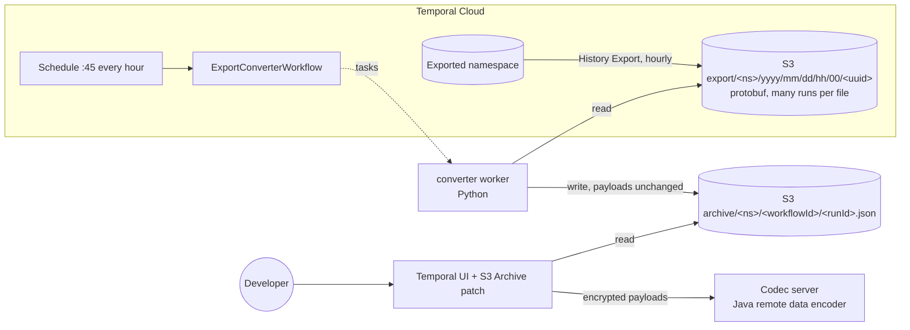
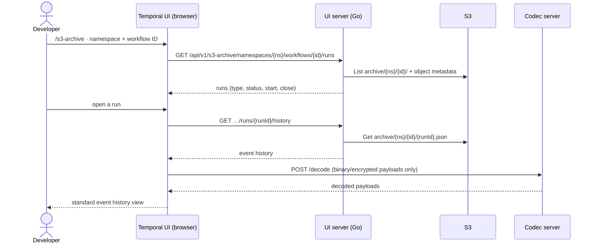
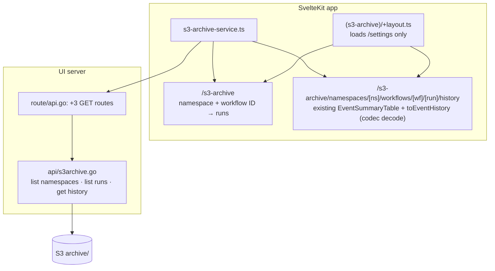

# S3 archive viewer for Temporal Cloud

Look up workflows that are past Temporal Cloud retention, by workflow ID, in a Temporal UI. Source: Cloud **Workflow History Export** to S3. Encrypted (codec) and plain payloads both display.



## Request journey



## Prerequisites

| | |
|---|---|
| Temporal Cloud | History Export to S3 enabled on the namespace to archive ([docs](https://docs.temporal.io/cloud/export)). A namespace + API key for the converter (its own namespace recommended). |
| AWS | Credentials that can read the export prefix, and write and read `archive/` (local runs use `AWS_PROFILE`). |
| Local | Docker with Compose. |

## Run it

```bash
cp .env.example .env            # fill in namespace, API key, bucket, region, AWS profile
docker compose up -d --build    # codec-server :8888, converter worker, UI :8080
```

Convert what is already in the bucket (hours are the UTC export folders), then create the hourly Schedule:

```bash
docker compose run --rm converter python convert_once.py 2026/11/12/15 2026/11/12/16
docker compose run --rm converter python schedule.py create      # add --paused to create it paused
```

Open <http://localhost:8080/s3-archive>, pick the namespace, enter a workflow ID, open a run.

`schedule.py trigger | pause | unpause | describe` manage the Schedule. Keep the worker running while the Schedule is active.

## What runs where

| Piece | Folder | Notes |
|---|---|---|
| Converter workflow, activities, worker | [`converter/`](converter/) | Based on Temporal's [Parquet export sample](https://github.com/temporalio/samples-python/tree/main/cloud_export_to_parquet). Each run reads the export folders for the 6 hours before its scheduled time (`TemporalScheduledStartTime`), skips files with a `_converted/` marker, writes one JSON per run, then the marker. Unreadable histories are skipped individually; their file is copied to `archive/_quarantine/` with an `.errors.txt`. Scheduled runs time out after 50 min so a stuck run never blocks the next hour. |
| Codec server | [`codec-server/`](codec-server/) | `RDEHttpServer` from [`temporal-remote-data-encoder`](https://github.com/temporalio/sdk-java/tree/main/temporal-remote-data-encoder) + samples-java [`CryptCodec`](https://github.com/temporalio/samples-java/tree/main/core/src/main/java/io/temporal/samples/encryptedpayloads). **Demo only**: CryptCodec's key travels in payload metadata. Swap in a KMS codec for real data; it must match the codec your workers use. |
| Patched UI | [`ui/`](ui/) | `Dockerfile` fetches `temporalio/ui` at [`UPSTREAM_COMMIT`](ui/UPSTREAM_COMMIT), applies [`s3-archive.patch`](ui/s3-archive.patch), builds. |

S3 layout written by the converter:

```
archive/<namespace>/<url-encoded workflowId>/<runId>.json     # {"events":[...]}, payloads as exported
                                                              # metadata: workflow-type, status, start-time, close-time
archive/_converted/<export key>.done                          # one marker per converted export file
archive/_quarantine/<export key>[.errors.txt]                 # files with unreadable histories (good runs still written)
```

## Changes to the stock Temporal UI



| File | Change | Why |
|---|---|---|
| `server/server/api/s3archive.go` | **new** | Three read-only routes. Builds S3 keys server-side from validated namespace and run ID and the URL-encoded workflow ID; uses the same auth check as the Temporal API routes (`ValidateAuthHeaderExists`: verifies the JWT when OIDC is configured, otherwise only that the header is present). Config by env: `S3_ARCHIVE_BUCKET`, `S3_ARCHIVE_PREFIX`, `S3_ARCHIVE_REGION`. |
| `server/server/route/api.go` | +3 lines | Registers the routes. |
| `server/go.mod`, `go.sum` | deps | AWS SDK for Go v2 (`config`, `service/s3`). |
| `src/routes/(s3-archive)/+layout.ts`, `+layout.svelte` | **new** | Own route group: the stock `(app)` layout waits on `/cluster-info`, which needs a Temporal server. This layout needs only `/settings`, so the UI runs with no Temporal server. |
| `src/routes/(s3-archive)/s3-archive/+page.svelte` | **new** | Namespace + workflow ID search, runs table. |
| `src/routes/(s3-archive)/s3-archive/namespaces/[namespace]/workflows/[workflow]/[run]/history/+page.svelte` | **new** | Reuses `EventSummaryTable`; data goes through `toEventHistory`, so the configured codec endpoint decrypts payloads exactly as for live runs. Path params match upstream so event components render. Links into live-workflow pages (event ID, task queue) are disabled, since those pages need a Temporal server. |
| `src/lib/services/s3-archive-service.ts` | **new** | Fetch helpers for the three routes. |

No other upstream files change. To upgrade, bump `UPSTREAM_COMMIT` and re-apply the patch.

## Verified

Test export: 2 files, 22 runs (19 plain, 3 encrypted).

| Check | Result |
|---|---|
| Converted history vs `temporal workflow show` (plain and encrypted run) | Same event IDs, types and result payloads |
| Re-running the converter | 0 files, 0 runs (markers) |
| Workflow IDs with `/` (child workflows) | Listed separately from the parent; open correctly |
| Encrypted run with codec server up / down | Decoded JSON / ciphertext |
| UI with no Temporal server behind it | S3 Archive pages load; stock pages do not (need a server) |
| Schedule trigger | Read `TemporalScheduledStartTime` and checked the previous hours |
| One unreadable history in a batch | Other runs in the file still written; error recorded |
| Event table: expand a row, click event ID / task queue, unknown workflow ID | Details shown; stays on the archive page; empty-state message |
| `docker compose` stack (codec server, converter worker, UI) | Converter reads and writes S3 from the container; UI on :8080 shows plain and encrypted runs |

**Not covered yet:** signal, terminate, cancel, timeout, Continue-As-New and reset runs (not yet delivered by the test export); KMS codec; auth-enabled UI.

## Limits

- Lookup by workflow ID only; search-attribute filters need an index.
- Cloud delivers a run up to 24 h after it closes, spread over several hourly files.
- Archive-only UI: stock pages for live workflows need a Temporal connection (the UI server supports mTLS, not API keys).
- Protect the UI with OIDC (`TEMPORAL_AUTH_*`) before exposing it; without auth, anyone who can reach it can read the archive.
- The codec server has no auth and allows any origin (`RDEHttpServer` defaults); keep it on a private network or put it behind a proxy.
- Closed runs from before export was enabled are not exported by Cloud; backfill them from the API while still in retention.

## Recording

<!-- RECORDING: add the screen recording of the end-to-end flow here -->
