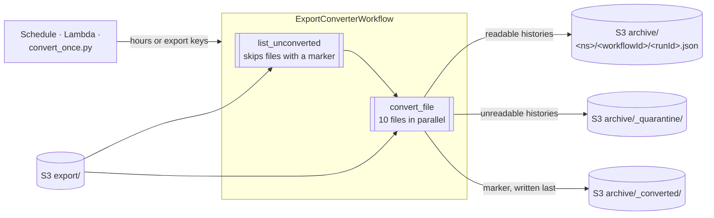
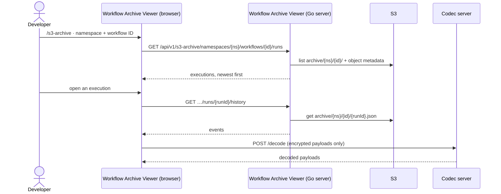
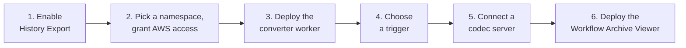
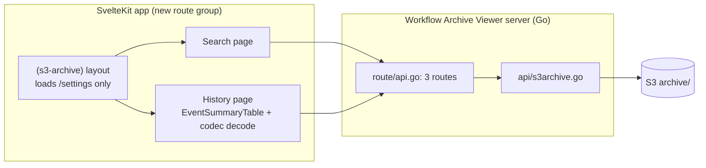
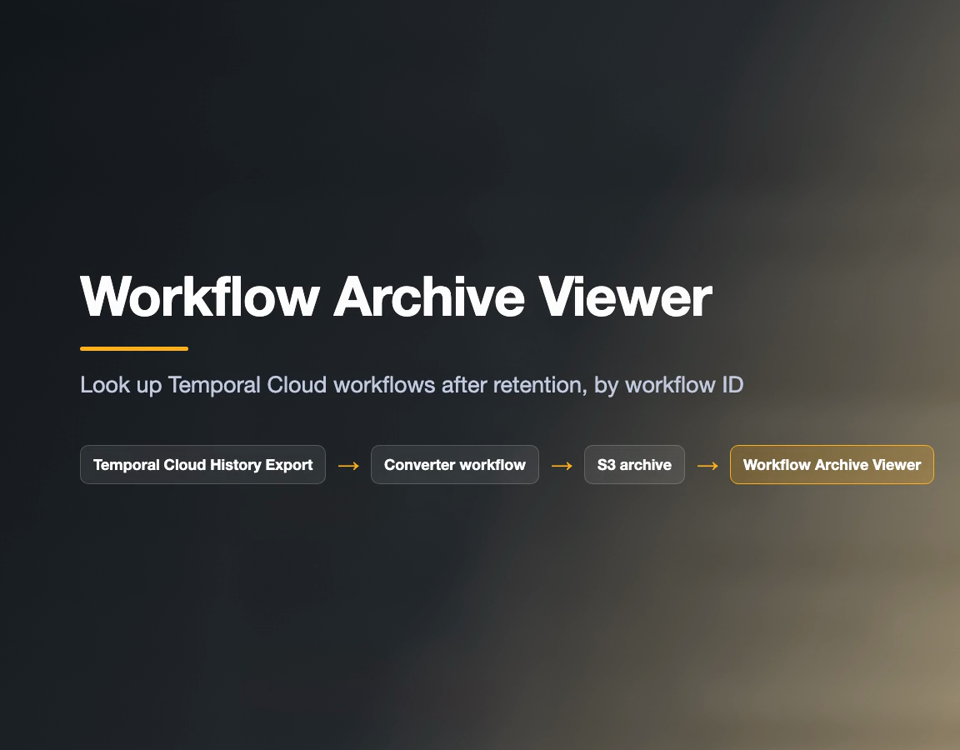

# Workflow Archive Viewer for Temporal Cloud

Temporal Cloud deletes closed workflow executions once they reach the namespace [retention period](https://docs.temporal.io/evaluate/cloud/limits) (1 to 90 days, default 30). The Workflow Archive Viewer keeps them viewable: a developer enters a workflow ID and opens any of its executions in the Temporal event history view, with encrypted payloads decoded.

The source is Temporal Cloud [Workflow History Export](https://docs.temporal.io/cloud/export), which copies closed executions to S3. No Temporal server or database is added.

## 1. Architecture

History Export copies closed executions from Temporal Cloud to S3 as hourly batch files. A converter workflow splits each batch into one S3 object per workflow execution, keyed by workflow ID; the Workflow Archive Viewer reads those objects, and a codec server decodes encrypted payloads in the developer's browser.


| Component | What it is | Folder |
|---|---|---|
| Converter | Temporal workflow, activities and Schedule that split each export batch into one S3 object per workflow execution. Based on Temporal's [Parquet export sample](https://github.com/temporalio/samples-python/tree/main/cloud_export_to_parquet). | [`converter/`](converter/) |
| Workflow Archive Viewer | `temporalio/ui` at a pinned commit plus [`s3-archive.patch`](ui/s3-archive.patch). Adds the `/s3-archive` pages and three read-only API routes. Developers need no S3 access; the Workflow Archive Viewer reads S3 with its own role. | [`ui/`](ui/) |
| Codec server | Java [remote data encoder](https://github.com/temporalio/sdk-java/tree/main/temporal-remote-data-encoder) with the samples-java [`CryptCodec`](https://github.com/temporalio/samples-java/tree/main/core/src/main/java/io/temporal/samples/encryptedpayloads). Demo only; replace with your codec ([step 5](#step-5-connect-a-codec-server)). | [`codec-server/`](codec-server/) |

## 2. Why a converter is needed

| History Export writes | Consequence |
|---|---|
| Hourly batch files, many executions per file, as one protobuf message | One execution cannot be read without downloading and parsing the whole file |
| `temporal-workflow-history/export/<ns>/<yyyy>/<mm>/<dd>/<hh>/00/<uuid>`: batch hour and a random name | Nothing in the key identifies the workflows inside |
| An execution can arrive in any batch up to 24 h after it closes | A date-based lookup would scan a day of extra files |

Temporal Cloud has no Archival API over exported data, and AWS has no service that reshapes protobuf in place. Converting each batch once, when it arrives, turns every lookup into a single S3 prefix list.

| Design choice | Reason |
|---|---|
| One S3 object per execution, keyed by namespace and workflow ID | Lookup without a database or index |
| Execution summary (type, status, start, close) as object metadata | The executions list loads without downloading histories |
| A `_converted/` marker per export file | Progress lives in S3; re-runs skip finished files, a crash re-converts only unfinished ones |
| Payloads copied unchanged | The converter holds no keys and data stays encrypted at rest; decoding happens only when viewed |
| Converter as a Temporal workflow | Retries, execution history and backfill on the platform you already run |

## 3. Trigger options

The converter workflow can be started by an hourly Temporal Schedule (included) or by an S3 ObjectCreated event that invokes a Lambda function. The Lambda is a simple function that only starts the workflow and is not covered in this repository. Both options are valid. Choose based on how quickly archives need to appear and which components your team wants to operate. Neither reduces Cloud History Export's delivery delay.

### Option 1: Temporal Schedule

The included [Schedule](converter/schedule.py) starts the converter at :45 each hour and checks the previous six export hours.

- **Pros:** no Lambda to deploy; revisiting recent hours recovers unprocessed files without relying on event delivery.
- **Cons:** new files wait for the next scheduled run; S3 is listed even when no files arrive. Outages beyond the lookback window need a backfill.

### Option 2: S3 ObjectCreated event → Lambda → workflow

Configure an [S3 notification to invoke Lambda](https://docs.aws.amazon.com/lambda/latest/dg/with-s3.html) when an export object arrives. Lambda reads the namespace from the object key and calls [`start_workflow`](https://python.temporal.io/temporalio.client.Client.html#start_workflow) on `ExportConverterWorkflow` with `ConvertInput(namespace=..., export_keys=[key])` on the converter's task queue (default `s3-archive-converter`). Lambda returns once Temporal accepts the start; the converter worker converts that one object.

- **Pros:** conversion starts seconds after an object arrives; no S3 listing.
- **Cons:** adds a Lambda deployment, invocation permissions, Temporal credentials and network access from Lambda, and monitoring for failed starts. A missed or failed notification is not retried by anything else; recover with `convert_once.py`.

The workflow already accepts `export_keys`. When adding the Lambda function and the S3 notification:

- Filter notifications to `temporal-workflow-history/export/` so archive and marker writes do not trigger new conversions.
- S3 can deliver [duplicate notifications](https://docs.aws.amazon.com/AmazonS3/latest/userguide/EventNotifications.html). Derive the workflow ID from the object key, use ID conflict policy `USE_EXISTING` and reuse policy `ALLOW_DUPLICATE_FAILED_ONLY`, and treat "already started" as success.
- Set a workflow execution timeout, Lambda retries and an on-failure destination for starts that fail.

Use the Schedule for simpler periodic collection, or Lambda when prompt conversion after export arrival justifies the extra AWS integration.

## 4. Converter



| Piece | Behavior | Code |
|---|---|---|
| Schedule | Cron `45 * * * *` (Cloud writes hour folder H at about H+1:15). 1-day catch-up window; a run is skipped while the previous one is running; 50-minute run timeout. | [`schedule.py`](converter/schedule.py) |
| Workflow | Input selects the files: `export_keys` (Lambda) converts those objects only; `hours` (`convert_once.py`) lists those hours; neither (Schedule) lists the 6 hours before `TemporalScheduledStartTime`. Returns hours, files, executions and quarantined files. | [`workflows.py`](converter/workflows.py) |
| Activities | `list_unconverted` (2 min) and `convert_file` (15 min, heartbeat per execution). Retry from 5 s to 5 min, no attempt limit. | [`activities.py`](converter/activities.py) |
| Parsing | No I/O. Run ID is `originalExecutionRunId`, or the new run ID for a reset. Status comes from the last event. | [`archive_format.py`](converter/archive_format.py) |
| Worker | Task queue `s3-archive-converter`, 10 activity threads; serves every namespace that exports to the same bucket | [`worker.py`](converter/worker.py) |

| Failure | Result |
|---|---|
| S3 error (throttling, network, access) | Retried until the run times out. The Schedule revisits recent files on its next run. A file that keeps failing holds up the files queued after it. |
| One unreadable history | Only that execution is skipped; the file goes to `_quarantine/` with an `.errors.txt` |
| Whole file unreadable | The file goes to `_quarantine/` |
| Crash before the marker | The file is converted again; writes overwrite, as do duplicate deliveries from Cloud |
| Worker down for more than 6 hours with the Schedule | Run `convert_once.py` for the missed hours |

## 5. Viewing a workflow execution



```text
temporal-workflow-history/export/<ns>/<yyyy>/<mm>/<dd>/<hh>/00/<file>   # written by Cloud; source of record
archive/<ns>/<url-encoded workflowId>/<runId>.json                      # {"events": [...]}, payloads unchanged
archive/_converted/<export key>.done                                    # one marker per converted file
archive/_quarantine/<export key>[.errors.txt]                           # files with unreadable histories
```

`archive/` is `ARCHIVE_PREFIX` in `ARCHIVE_BUCKET` (default: the export bucket). Workflow IDs are URL-encoded into one key segment, so `order-1/shipment` and `order-1` stay separate.

## 6. Set up



### Step 1. Enable History Export

Enable [History Export to S3](https://docs.temporal.io/cloud/export/aws-export-s3) on each namespace to archive. The bucket must be in the namespace's region, and only executions that close after export is enabled are exported.

### Step 2. Pick a namespace and grant AWS access

The converter can run in any namespace you choose. A separate [namespace](https://docs.temporal.io/cloud/namespaces) with its own [API key](https://docs.temporal.io/cloud/api-keys) is recommended: if the converter runs in an exported namespace, its own executions are exported and archived too.

| Identity | Permissions | Used in |
|---|---|---|
| Converter worker | `s3:GetObject` on `temporal-workflow-history/export/<ns>/*`, `s3:PutObject` on `archive/*` | [`activities.py`](converter/activities.py) |
| Workflow Archive Viewer | `s3:GetObject` on `archive/*` | `s3archive.go` in [`s3-archive.patch`](ui/s3-archive.patch) |
| Both | `s3:ListBucket` limited to those prefixes with an [`s3:prefix` condition](https://docs.aws.amazon.com/AmazonS3/latest/userguide/amazon-s3-policy-keys.html) | |

Use your organization's AWS authentication, for example a workload IAM role; both services use the default AWS credential chain. This kit uses a local profile from the mounted `~/.aws`.

### Step 3. Deploy the converter worker

| Option | How |
|---|---|
| **Separate lightweight worker (recommended)** | Build [`converter/Dockerfile`](converter/Dockerfile) and run `python worker.py`. It polls only `s3-archive-converter`, so conversion load and S3 credentials stay apart from business workers. |
| Existing Python worker | Register `ExportConverterWorkflow`, `list_unconverted` and `convert_file` from [`converter/`](converter/) on an existing worker, with a thread-pool `activity_executor` (the activities are synchronous) and `boto3` installed. Set `CONVERTER_TASK_QUEUE` to that worker's task queue wherever the converter is started. |

One worker serves every namespace that exports to the same bucket.

| Variable | Value |
|---|---|
| `TEMPORAL_ADDRESS`, `TEMPORAL_NAMESPACE`, `TEMPORAL_API_KEY` | Endpoint, name and API key of the namespace the converter runs in |
| `EXPORTED_NAMESPACE` | Namespace being archived (read by `schedule.py` and `convert_once.py`) |
| `EXPORT_BUCKET` | Bucket that History Export writes to |
| `ARCHIVE_BUCKET`, `ARCHIVE_PREFIX` | Archive location; defaults are `EXPORT_BUCKET` and `archive` |
| `AWS_REGION` | Bucket region |
| `CONVERTER_TASK_QUEUE` | Optional; default `s3-archive-converter`. Must match the worker's task queue. |

Convert what is already exported, by UTC hour folder: `python convert_once.py 2026/11/12/15 2026/11/12/16`.

### Step 4. Choose a trigger

| Option | Action |
|---|---|
| 1. Temporal Schedule | `python schedule.py create` once per exported namespace (`--paused` to create it paused) |
| 2. S3 ObjectCreated event | Add the Lambda function and S3 notification described in [Trigger options](#3-trigger-options); one notification can cover every namespace's export prefix |

### Step 5. Connect a codec server

Skip this step for namespaces without payload encryption. Otherwise use the codec server that already serves your workers' codec, or build [`codec-server/`](codec-server/) with your codec in place of the demo [`CryptCodec.java`](codec-server/src/main/java/codecserver/CryptCodec.java), whose key travels in payload metadata. The URL must be reachable from developers' browsers and kept private: the included server has no authentication and allows any origin.

### Step 6. Deploy the Workflow Archive Viewer

Build [`ui/Dockerfile`](ui/Dockerfile) and run it where developers can reach it. Developers open `<viewer-url>/s3-archive`. Access control is required, since anyone who can reach the Workflow Archive Viewer can read every archived namespace: use its built-in OIDC login (variables below) or your existing SSO proxy or private network.

| Variable | Value |
|---|---|
| `S3_ARCHIVE_BUCKET`, `S3_ARCHIVE_PREFIX`, `S3_ARCHIVE_REGION` | Same archive location and region as the converter |
| `TEMPORAL_CODEC_ENDPOINT` | Codec server URL from step 5 |
| `TEMPORAL_AUTH_ENABLED`, `TEMPORAL_AUTH_PROVIDER_URL`, `TEMPORAL_AUTH_CLIENT_ID`, `TEMPORAL_AUTH_CLIENT_SECRET`, `TEMPORAL_AUTH_CALLBACK_URL` | Optional. Only for the built-in OIDC login; not needed when an SSO proxy or private network controls access. |
| `TEMPORAL_ADDRESS` | Required at start-up but not used by the archive pages; any `host:port` |

### Try it locally

[`docker-compose.yml`](docker-compose.yml) runs the codec server (:8888), the converter worker and the Workflow Archive Viewer (:8080) with a local AWS profile.

```bash
cp .env.example .env            # converter namespace, exported namespace, bucket, region, AWS_PROFILE
docker compose up -d --build
docker compose run --rm converter python convert_once.py 2026/11/12/15 2026/11/12/16
docker compose run --rm converter python schedule.py create      # Option 1
```

Open <http://localhost:8080/s3-archive>, choose the namespace, enter a workflow ID and open an execution.

## 7. UI patch

[`ui/Dockerfile`](ui/Dockerfile) fetches `temporalio/ui` at [`UPSTREAM_COMMIT`](ui/UPSTREAM_COMMIT), applies the patch and builds. Only the files below change. To upgrade, update `UPSTREAM_COMMIT` and `UI_COMMIT` in the Dockerfile and re-apply the patch.



| File | Change |
|---|---|
| `server/server/api/s3archive.go` | New. Read-only routes: list namespaces, list executions, get history. Validates namespace and run ID, encodes the workflow ID as the converter does, applies the Workflow Archive Viewer's auth check (JWT verified when OIDC is on). Configured by `S3_ARCHIVE_BUCKET`, `S3_ARCHIVE_PREFIX`, `S3_ARCHIVE_REGION`. |
| `server/server/route/api.go` | Registers the routes ahead of the catch-all Temporal API route |
| `server/go.mod`, `go.sum` | AWS SDK for Go v2 |
| `src/routes/(s3-archive)/` | New route group whose layout loads only `/settings`, so no Temporal server is needed. The history page reuses `EventSummaryTable`, so codec decoding works as for live workflows, and blocks links to live-workflow pages. |
| `src/lib/services/s3-archive-service.ts` | Fetch helpers for the routes |

## 8. Demo recording

[](docs/workflow-archive-viewer-demo.mp4)


End-to-end run, 1:41, no audio: History Export files in S3 → the converter workflow run → one object per workflow execution → the execution deleted from Temporal Cloud → found again in the Workflow Archive Viewer, with encrypted payloads decoded.
